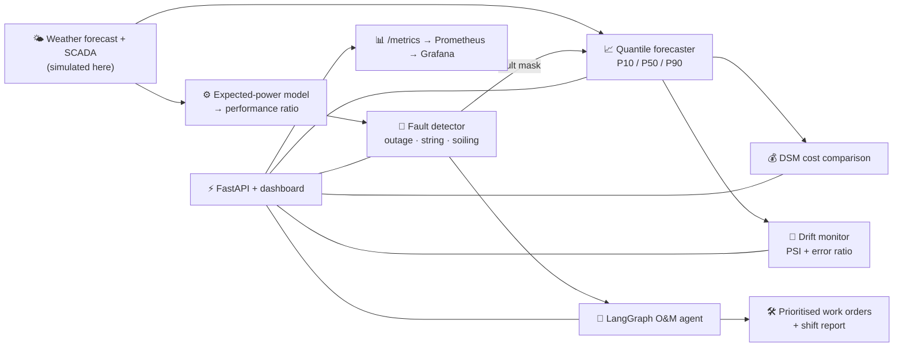
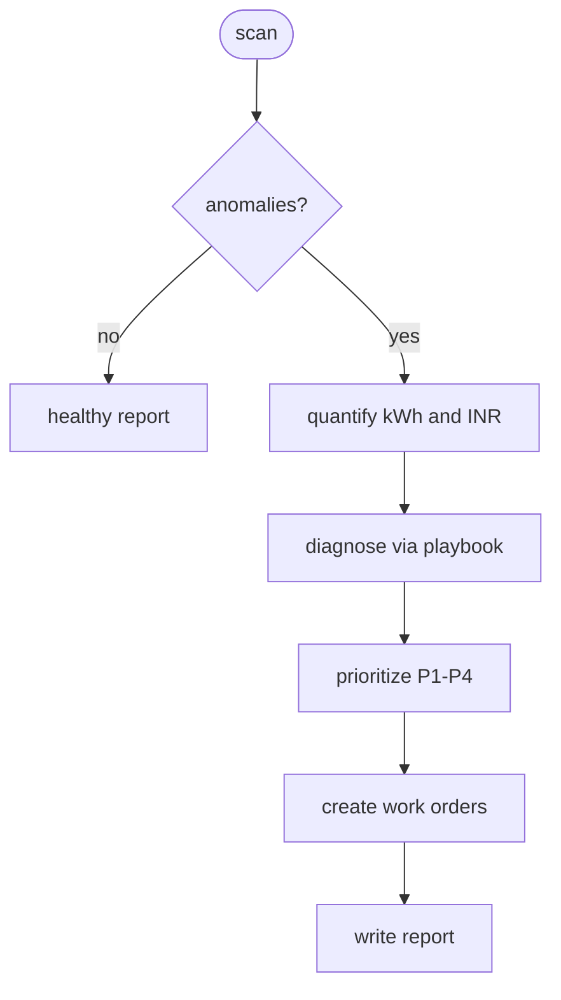

<div align="center">

# ☀️ SolarSense

### Probabilistic solar forecasting + automatic fault detection + an O&M agent that writes the work orders


</div>

---

## 🎯 The industry problem

Utility-scale solar plants lose money in two quiet ways:

| 💸 Leak | What happens |
|---|---|
| **Forecast error** | Generators must schedule output a day ahead. Deviations beyond a tolerance band are charged under deviation-settlement (DSM-style) rules, so a bad forecast costs real money. |
| **Undetected underperformance** | An inverter trip, a blown string fuse or heavy soiling can cut output for days before anyone notices, because output also moves with the weather. |

## 💡 The solution

1. **Forecast with uncertainty:** quantile gradient boosting gives P10/P50/P90 for every 15 minutes of the next day, from NWP-style weather inputs.
2. **Separate weather from faults:** a physics-informed expected-power model calibrated at commissioning turns every reading into a *performance ratio* (actual ÷ expected). Weather cancels out, so faults stand out.
3. **Detect and classify:** explainable rules find inverter outages, string faults (step drop in PR) and soiling (slow decline).
4. **Self-cleaning training data:** detected fault periods are excluded when the forecaster is trained, so it does not learn from broken plant behaviour.
5. **Agent:** a LangGraph agent quantifies the loss in kWh and ₹, maps it to an O&M playbook, prioritises (P1–P4) and drafts work orders. An LLM only phrases the final note, and the system works fully offline without one.
6. **MLOps:** drift monitoring (PSI + error ratio), retrain endpoint, Prometheus metrics, Grafana, Docker, CI.

## 🧠 Architecture





## 📊 Results (simulated plant, 90 days train / 60 days validation)

| Metric | Value |
|---|---|
| Forecast nMAE (P50, % of capacity) | **4.7 %** vs **10.6 %** for yesterday-persistence |
| P10–P90 interval coverage | **69 %** (nominal 80 %, so intervals are slightly narrow) |
| Fault detection | **3 of 3** injected faults found, on the correct days (2 inverter outages, 1 string fault) |
| False fault alarms on a healthy plant | **0** (tested) |
| Illustrative DSM cost vs persistence | **−84 %** under the default assumptions |
| Drift monitor | Flags **retrain**, correctly: temperature PSI is high because validation months are hotter than training months |

> ⚠️ **Read this honestly.** The data is **synthetic** (physics-based simulator with injected faults and ground-truth labels), so absolute numbers will not transfer to a real plant. The DSM rules are **simplified and illustrative**, not the regulatory formula. What this project demonstrates is the *system*: pipeline, detection logic, agent, monitoring and tests. To use real data, return the same columns from a SCADA/CSV loader in place of `simulate()`.

## 🗂️ Structure

```
solarsense/
├── src/solarsense/
│   ├── config.py                 # typed settings (env / .env)
│   ├── service.py                # data, models, cached predictions, retrain
│   ├── data/simulator.py         # plant simulator with fault injection
│   ├── ml/{features,forecast,dsm}.py
│   ├── monitoring/{anomaly,drift}.py
│   ├── agent/{graph,playbook}.py # LangGraph agent + O&M knowledge base
│   └── api/main.py               # FastAPI, /metrics, serves the dashboard
├── web/index.html                # dashboard (Chart.js)
├── scripts/train.py              # rebuild + retrain + validation report
├── tests/                        # 17 tests: simulator, detection, forecast, DSM, drift, agent, API
├── monitoring/                   # Prometheus + Grafana provisioning
├── Dockerfile · docker-compose.yml · Makefile · .github/workflows/ci.yml
```

## 🚀 Run it

```bash
pip install -r requirements-dev.txt
make train                  # builds data, detects faults, trains, prints a report
make run                    # http://localhost:8000  (dashboard) · /docs (API)
make test                   # 17 tests
docker compose up --build   # API :8000 · Prometheus :9090 · Grafana :3000
```

Optional `.env` (see `.env.example`): `GROQ_API_KEY` for LLM-written reports, `SOLARSENSE_ADMIN_API_KEY` to enable retraining.

## 🔌 API

| Method | Path | Purpose |
|---|---|---|
| GET | `/api/forecast?day=YYYY-MM-DD` | P10/P50/P90 vs actual for a day |
| GET | `/api/anomalies?days=30` | detected faults with kWh / ₹ loss |
| GET | `/api/performance?days=60` | daily performance ratio |
| GET | `/api/dsm?days=14` | illustrative penalty: model vs persistence |
| GET | `/api/drift` | PSI per feature, error ratio, retrain flag |
| POST | `/api/diagnose` | run the agent → findings, work orders, report, trace |
| POST | `/api/retrain` | admin only (`X-Admin-Key`); refit and bump model version |
| GET | `/metrics` | Prometheus: performance ratio, open anomalies, nMAE, PSI, model version |

## ⚠️ Limitations and roadmap

- Simulated data only; plug in real SCADA + NWP feeds
- P10–P90 intervals are under-covered (69 % vs 80 %): add conformal calibration
- Fault rules are intentionally simple and explainable; add an ML detector as a second opinion
- Grafana is provisioned with the data source only; build panels on the `solarsense_*` metrics
- Detection runs on request; schedule it (cron / Celery) and alert via Slack or email

## 💼 Resume bullets

- Built an end-to-end solar O&M platform: day-ahead P10/P50/P90 forecasting (quantile GBM) cutting nMAE from 10.6 % to 4.7 % vs persistence on a simulated plant
- Designed a performance-ratio fault detector (inverter outage, string fault, soiling) that found 3/3 injected faults with 0 false alarms on a healthy plant
- Implemented a LangGraph agent that quantifies ₹ loss, prioritises P1–P4 and drafts work orders; works offline, LLM optional
- Productionised with FastAPI, drift monitoring (PSI), retrain endpoint, Prometheus/Grafana, Docker and GitHub Actions CI (17 tests)
